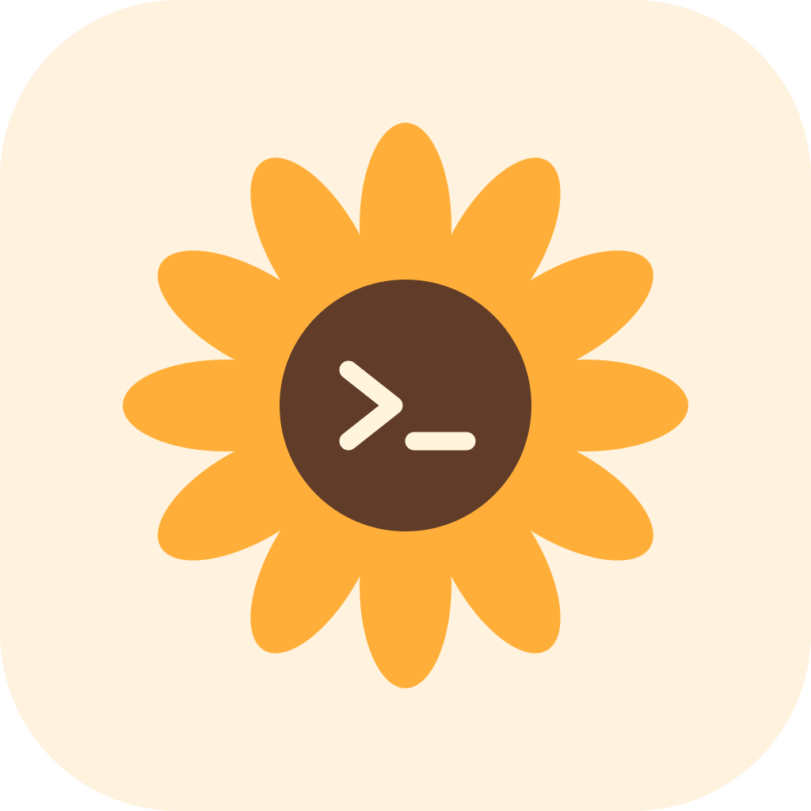

<div align="center">


# 大小姐的网络手账

**今天也要见到大小姐。把网络的来去，认真记下来。**

Claude Code 网络路径观察 · IP 漂移历史 · macOS / Windows 托盘常驻

[下载安装](https://github.com/Be1Human/claude-ojousama-network/releases/latest) · [构建与测试](https://github.com/Be1Human/claude-ojousama-network/actions) · [设计与验证](docs/设计与验证.html) · [English](#english)


*实际应用截图，全部为演示数据。原创同人风格，非 Anthropic 官方产品。*
</div>

## 能观察什么

- **Claude 相关路径**：按 Claude Code 的 HTTP(S) 代理变量访问 `api.anthropic.com` / `claude.ai` 的公开边缘 trace；返回有效 IP 时记录来源、时间与变化。另用独立 Chromium 会话观察系统浏览器近似路径。
- **中国 / 中国香港出口警告**：检测到中国（CN）或中国香港（HK）归属时，顶部提示具体检测项目及 IPv4/IPv6，出口与路径卡片显示对应地区的红色警告；历史保留“当时为中国出口”或“当时为中国香港出口”标记。过期结果会注明过期，其他地区、未知归属和探测失败不误报。归属地为第三方数据库估计。
- **IP 历史**：分别记录 IPv4 / IPv6、系统路由、CLI 回显、目标域名；成功、失败和变化均保留。GeoIP 国家、城市、ASN、运营商、查询来源与时间可追溯。
- **网络稳定性**：Cloudflare / GitHub 两个公共 HTTPS 目标的成功率、响应耗时、P95、同时失败事件；休眠与采样间隔单独记录。
- **日常后台使用**：托盘常驻、关闭窗口隐藏、暂停/继续、立即检测、可选开机启动、变化通知、筛选和全部 CSV 导出。
- **数据留在本机**：SQLite 历史；代理认证信息通过 macOS Keychain / Windows DPAPI 支持的 Electron safeStorage 加密保存。没有本项目的遥测或上传服务器。公共探测与 GeoIP 服务仍会收到相应请求。

## 安装与开始

从 [Releases](https://github.com/Be1Human/claude-ojousama-network/releases) 下载适合设备的文件：

| 系统 | 文件 |
| --- | --- |
| Mac Apple Silicon（M 系列） | `mac-arm64.dmg` 或 `mac-arm64.zip` |
| Mac Intel | `mac-x64.dmg` 或 `mac-x64.zip` |
| Windows 10/11 x64 | `win-x64.exe` 安装器或 `win-x64.zip` 解压版 |

包内自带 Electron / Node / SQLite，无需另装 Python 或 Node。macOS 13 或更新版本将应用拖入 Applications；Windows 按安装器提示操作。当前个人发布包**没有 Apple 公证或 Windows 代码签名**，系统可能要求在其安全提示中确认来源；请只下载本仓库发布文件并核对 SHA-256。不要全局关闭安全保护。

首次打开默认每 30 秒观测，开机启动与通知默认关闭。点击窗口关闭按钮会隐藏到托盘；彻底退出请用托盘菜单。

### 尽量贴近你启动 Claude Code 的环境

1. 打开「Claude 路径」，点击「复制终端采集命令」。
2. 将命令粘贴到**准备运行 Claude Code 的同一个终端**并执行。应用会接收白名单网络变量，不接收 API Key、OAuth Token 或完整进程环境。
3. 如有项目级 `.claude/settings.json` / `settings.local.json`，点击「选择 Claude 项目」。
4. 查看代理来源和提示，再立即检测。已有 Claude Code 进程可能保留旧启动环境；在 Claude Code 的 `/status` 中自行核对 Proxy。

也可用 `node scripts/capture-env.mjs /path/to/network-profile.json` 生成只含网络变量的快照，再从应用导入。快照可能包含代理密码，不要上传；导入后妥善保管或删除。应用只改变自身探测设置，不修改 Claude、VPN、系统代理或网络策略。

自动读取用户、所选项目及本地 managed settings 文件中白名单 `env` 字段；不读取认证文件。远程管理策略、MDM、启动参数、包装器、其他机器/容器、云会话、扩展与已经运行的后台会话并未完整复现。

## 怎样理解结果

| 显示内容 | 能证明的范围 |
| --- | --- |
| 域名边缘回显 | 此次无凭据探测到该域名的 Cloudflare 边缘看到的源 IP；端点随时可能停止提供该信息 |
| 系统浏览器近似 | 独立 Chromium 会话遵循系统代理的观测；不代表外部浏览器的插件、独立代理或既有会话 |
| 第三方 IP 回显 | 请求 ipify / icanhazip 的出口；按域名、进程或协议分流时不一定等于 Claude |
| GeoIP 城市 | 第三方数据库估计，可能过期或互相矛盾；不是精确物理位置或住宅 IP 认证 |
| HTTPS 成功率 / P95 | 两个公共 HTTPS 目标的采样结果；不是 ICMP 丢包率、模型响应速度或账号可用率 |

这不是 Claude 登录模拟器：不登录账号、不拦截凭据、不调用模型、不绕过地区限制，也无法读取服务端实际登录审计。相同代理仍可能按目标域名分流。**IP 稳定、美国归属地或 trace 成功均不代表账户不会被限制。** 没有“防封评分”“零风险”或由数据驱动的“好感度”。大小姐台词只是同人彩蛋。

代理选择依据当前[官方文档](https://code.claude.com/docs/en/network-config)：`https_proxy` → `HTTPS_PROXY` → `http_proxy` → `HTTP_PROXY`；识别 `NO_PROXY` / `no_proxy`。不把 SOCKS 或 `ALL_PROXY` 当成 Claude Code 已支持的配置。额外 CA、mTLS 私钥、自定义证书库、CIDR bypass、Bedrock/Vertex/Foundry 等路径显示覆盖缺口。软件保留 TLS 校验。

## 本机数据与旧版导入

- macOS：`~/Library/Application Support/ClaudeOjouNetwork/`
- Windows：`%APPDATA%/ClaudeOjouNetwork/`
- `network.sqlite3` 保存观测；`settings.json` 保存一般设置及加密后的私有网络配置。
- 在 macOS 自动只读导入旧「网络观察」的 `~/Library/Application Support/NetworkWatch/ip-history.sqlite3`，记录标为「旧版」。按旧记录 ID 去重，原文件保留。
- CSV 导出包含原始 IP 与地理信息，且有公式注入防护。卸载时保留数据；需要彻底删除时先导出，再自行删除上述文件夹。

## 开发与验证

要求 Node 24 LTS，首次安装需要网络下载 Electron。

```sh
npm ci
npm test
npm run demo       # 完全合成的数据，不发起网络探测
npm run test:ui    # 实际 Electron 窗口：导航、筛选、设置、暂停、托盘恢复
npm run test:live  # 自愿真实网络探测；终端输出不包含原始 IP
npm start
npm run build:mac # 当前 Mac arm64
npm run build:win # Windows x64，建议在 Windows / CI 构建
```

v0.1.1 的 [21 项测试与三平台构建](https://github.com/Be1Human/claude-ojousama-network/actions/runs/40029382275)、[发布文件完整性验证](https://github.com/Be1Human/claude-ojousama-network/actions/runs/40029816641)均已通过；另可查看[Windows 中国出口警告演示截图](docs/assets/china-warning-windows-demo.png)。

[GitHub Actions](https://github.com/Be1Human/claude-ojousama-network/actions) 分别在 macOS arm64、macOS Intel 和 Windows x64 上执行逻辑测试、源应用 UI 测试、安装包构建、打包后应用 UI 测试。CI 自动运行不等于所有真实 Windows 设备、重启启动项、整夜监测或休眠恢复均已人工验收。

架构参考 codebuddy-mem 的托盘、单实例、后台工作进程和关闭隐藏模式，自主实现；没有复制其源代码。Electron 界面采用 contextIsolation / sandbox / CSP，网络与 SQLite 在独立 utilityProcess，前端没有 Node 权限或任意 URL 请求能力。单轮请求有超时、响应大小上限、无重叠轮询；工作进程失败最多自动重启三次。

## 美术与梗的来源

效果图先生成，用户提出“更二次元、先核对梗”后修订为 V2。角色、美术和图标为本项目新生成/绘制，未打包第三方画师作品。

- [V1 效果图](docs/assets/concept.png) / [V2 效果图](docs/assets/concept-v2.png) / [V2 提示词](docs/assets/concept-v2-prompt.txt)
- 社区人设语境：[温柔、能力强与严格“原生家庭”的讨论](https://linux.do/t/topic/3010391)、[“哈气大小姐”调侃](https://linux.do/t/topic/2990653)、[Claude 娘二创条目](https://www.bilibili.com/video/BV1wtaH6jEk8/)。社区帖子用于核对同人语境，**不是服务政策或封号原因的证据**。
- 插画使用内置 imagegen 生成，提示词与历史方案在 `docs/assets/`；应用资产在 `assets/`。代码及本项目有权许可的生成美术按 MIT 提供；品牌名称归其权利人所有。本项目不宣称官方授权或代表真实 Claude 的人格、态度。

## English

**Claude Ojou Network** is an independent, anime-themed, local-first network diary for Claude Code users. It records public IPv4/IPv6 history, GeoIP provenance, HTTPS stability and domain-edge trace observations. A tray process keeps observing after the window closes. No login credentials are collected and no model calls are made. Public IP and GeoIP providers receive the diagnostic requests; there is no project telemetry backend.

Target-domain edge traces are observations of diagnostic requests, **not proof of the IP recorded by Claude authentication or API backends**. The external login browser and CLI may follow different routes. The application offers no account-risk score or ban-prevention guarantee.

Download macOS (Apple Silicon / Intel) and Windows x64 builds from Releases. Builds are currently unsigned / unnotarized. The source and applicable original assets are MIT licensed; this is not an Anthropic product.
